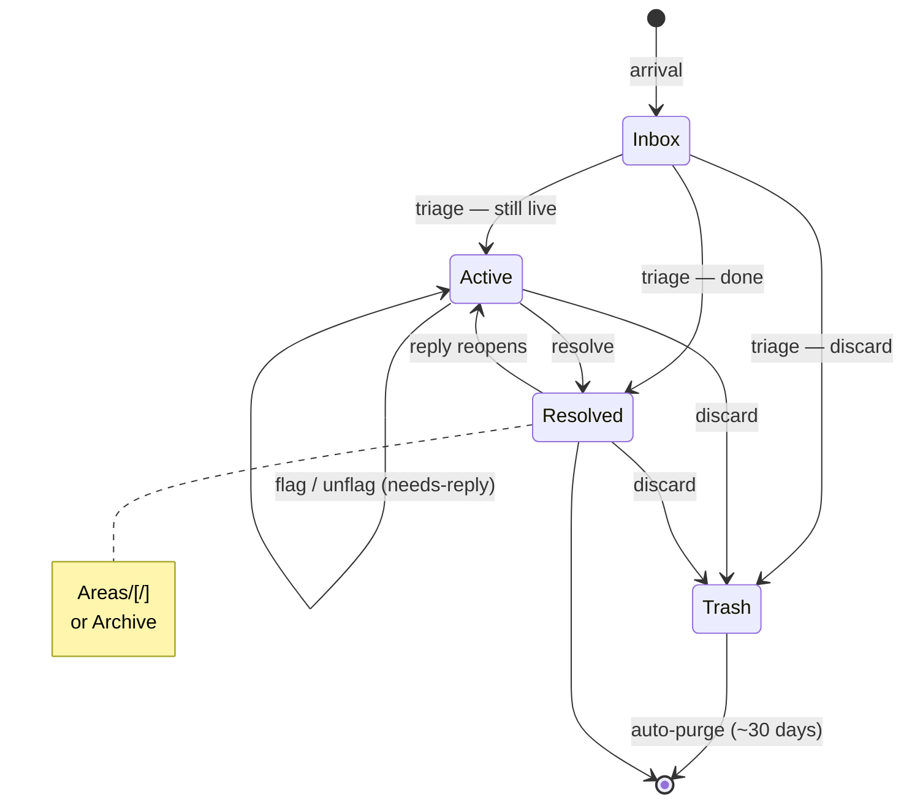

# Email Folder Taxonomy

Companion to `email-skill-design.md` / `implementation-plan.md`. Defines the
folder structure, flag semantics, and thread-state model the triage skill
operates against. Where this document and the design doc's §10 state tables
disagree, this document is the post-Phase-2 target (see "Migration" at the
end).

## Purpose

Pin down where a thread's lifecycle and category live so the triage tool has an
unambiguous target. The governing constraint: **all authoritative per-thread
state lives on the email server**, expressed only through primitives that
behave equivalently across both accounts — location and the standard system
flags. Nothing about a thread's *current* lifecycle or category depends on a
local database.

`history.db` holds no authoritative state, but it is not thread-blind: every
logged event snapshots the thread-state and category *as judged at decision
time*, and that append-only log is what the learning loop (sender stats, rule
proposals) runs on. The distinction is authority, not content — to know where a
thread stands **now**, you ask the server (via the mirror and index), never the
history. Beyond the event log, `history.db` also holds the things with no IMAP
analog at all: rule definitions, the predicate language, contacts, session
notes.

## Design principles

**GTD while live, PARA once resolved.** A thread in flight needs few states and
cheap decisions, and its topic often isn't settled yet — so the live tiers are
minimal and carry no category. A resolved thread is stable, so it earns the
richer, topic-based structure. Each system does the job it's good at, and
category is only judged once, against something that's stopped moving.

**Two guaranteed primitives only.** Custom IMAP keywords are not reliable across
accounts (Gmail models labels as mailboxes, not keyword flags; iCloud keyword
support isn't guaranteed). So state rides exclusively on location and the
standard `\Flagged` / `\Answered` / `\Seen` flags. No invented keywords.

**Canonical locations, per-account adapters.** The taxonomy is defined over
*logical* locations — `Inbox`, `Active`, `Areas/…`, `Archive`, plus the system
locations `Sent`, `Drafts`, `Trash`, `Junk`. Each account supplies an adapter
defining what physical state satisfies each name. On iCloud every adapter is a
1:1 real folder. On Gmail most are 1:1 labels, but `Archive` is defined by
*absence* (below), and `Trash`/`Junk` carry a retention property iCloud's
equivalents don't. The skill and index reason in canonical names only; the
adapters live in config and indexer logic. This is what lets both accounts'
native clients keep working untouched — no client-side behavior change is ever
required to preserve the taxonomy.

**Thread-centric.** State is a property of the thread, not of individual
messages. Where a flag is per-message but the state is per-thread, the tool
derives the thread value from the message graph (below).

**Mirrored, not merged.** Both accounts carry the same canonical structure. A
message is never moved between accounts — it is filed within whichever account
delivered it. A single logical Area may therefore hold threads in both
accounts, under the same canonical name in each. Retrieval reunifies at read
time (union across accounts via the index); there is no single physical folder
that holds all of an Area's mail, and that's fine.

## Canonical locations and adapters

| Canonical | iCloud adapter | Gmail adapter |
|-----------|----------------|---------------|
| `Inbox` | real folder | native `INBOX` label |
| `Active` | real folder | managed label |
| `Areas/<area>[/<project>]` | real nested folders | managed labels (nested via `/` in the name) |
| `Archive` | real folder | **virtual** — see below |
| `Sent`, `Drafts`, `Trash`, `Junk` | native folders | native labels |

**Gmail's `Archive` is virtual.** A Gmail message is archived, in Gmail's own
native sense, when it sits in `[Gmail]/All Mail` with no user label and is not
in Inbox/Sent/Trash/Spam. That is *exactly* what this taxonomy's `Archive`
means — resolved, no assigned category, the catch-all for resolved mail with
nowhere more specific to go — so rather than re-asserting it as a redundant
label on top of what Gmail already tracks, the indexer reads the native state
directly: a message whose only home is All Mail has tier `Archive`, derived at
index time as a computed column, never written back to the server. There is no
`Archive` label on Gmail and no `Archive` directory in the Gmail Maildir;
"show me Archive" is an index query, not a directory listing.

What this buys: **any client's native archive action is taxonomy-correct for
free.** Apple Mail's archive button on the Gmail account strips labels and
leaves the message in All Mail — which the index reads as `Archive`. On the
iCloud account the same button moves to the real `Archive` folder. No habit
retraining, no reconciliation sweep, no drift — there is nothing to keep in
sync because the native state *is* the definition.

Guardrails on the inference, both cheap:

- **Sent is excluded explicitly.** Sent messages also live in All Mail with no
  user label; they are handled by the Sent-correlation path (waiting-state
  derivation, thread rollup), never inferred as `Archive`.
- **An unrecognized label is its own signal, not an `Archive` fallthrough.** A
  legacy label outside the taxonomy means the folder audit (plan 2.3) hasn't
  finished its job; the indexer surfaces it rather than silently classifying
  the message as archived.

**Gmail's `Trash` and `Junk` auto-purge after ~30 days** — platform behavior,
not ours. The design's trash rule ("reversible for ~30 days" via move-to-Trash,
never expunge) reads as a comfortable floor on iCloud; on Gmail it is a hard
ceiling enforced server-side. Recorded here as an adapter property so it's a
documented divergence, not a surprise.

## Folder structure

Canonical structure, physically realized per the adapter table above:

```
<account root>
├── Inbox                     untriaged arrivals
├── Active                    triaged, still live
├── Areas/                    resolved, ongoing responsibility
│   ├── 5621-W-141st/
│   │   └── Fence             project subfolder (a bounded unit that can graduate)
│   ├── Taxes/
│   ├── Colorado-House-Search/
│   └── …
└── Archive                   resolved, no future relevance
                              (real folder on iCloud; virtual on Gmail)
```

Location encodes the **lifecycle tier**:

- **Inbox** — untriaged. The only tier that isn't a decision; it's just where
  delivery lands.
- **Active** — triaged and still open. Per-thread needs-reply state is carried
  by `\Flagged` (below), not by any subfolder.
- **Areas/** and **Archive** — resolved. This is the only tier that carries a
  category, and it's assigned exactly once, at resolution.

`Areas/` holds ongoing-responsibility buckets. A bounded project with a real end
date lives as a subfolder under its area (`Areas/5621-W-141st/Fence`) so the
whole subfolder is a single unit that can later graduate to `Archive`. A
one-off with no ongoing home goes straight to `Archive`.

Note the distinction between the **Active tier** and an **active real-world
project**: a still-live thread about the fence sits in `Active`, not in
`Areas/…/Fence`. The project subfolder is a *resolved-thread* container that
happens to belong to a project still underway. Threads land there only once
they're individually resolved; the subfolder graduates to Archive when the
project itself is done.

System folders (`Sent`, `Drafts`, `Trash`, `Junk`) sit **outside the tier
model**. In particular, your own replies stay in Sent permanently — every
replied-to thread is therefore physically split across Sent plus its tier
location, and thread membership reunifies at read time (the index's
INBOX+Sent rollup already depends on this). Filing sent messages into tier
folders is explicitly not done.

## Sync coverage

**Everything syncs.** Both accounts mirror in full — including `[Gmail]/All
Mail`, which is the *only* place natively-archived Gmail mail exists, and
therefore mandatory once `Archive` is virtual. The cost is that the Gmail
mirror holds a duplicate copy of every labeled message (once under its label,
once in All Mail); the indexer already dedups by Message-ID across folders for
the Sent rollup, and the same machinery absorbs this. At current account sizes
(~3 GB Gmail) the storage doubling is trivial and priced in.

There is no `Inactive/` parking lot and no sync-exclusion pattern. The
pre-taxonomy design excluded legacy folders from sync to bound the mirror; the
2.3 audit now *dissolves* legacy folders into `Areas/`/`Archive` instead of
parking them, and full local retrieval (the index reunifying Areas across
accounts, offline scanning of resolved mail) requires resolved tiers to be
mirrored anyway. Mail we'd exclude from the mirror no longer exists as a
category.

## Flag semantics

| Flag | Meaning | Set by | Coupled to lifecycle? |
|------|---------|--------|----------------------|
| `\Flagged` | Needs my reply / blocked on my action | Explicit triage decision only (any client's flag/star works — it's a queue-for-the-skill action) | Yes — derives thread needs-reply state |
| `\Answered` | I have sent a reply to this message | MUA, automatically on reply | No — bookkeeping input to the `waiting` derivation; queried, never acted on |
| `\Seen` | Read by **the user** | The user's own clients; Claude only ever by deliberate `flag add … seen` when content was actually shown | No — not repurposed |

`\Answered` and `\Flagged` are fully decoupled: `\Answered` records what was
done, `\Flagged` records what's still owed, and no rule keeps them in
agreement. Replying to a thread does not clear its flag; a flagged thread can
be answered and still awaiting my next action.

`\Seen` keeps its vanilla meaning, but with a hard behavioral rule attached
(design §4.5): it is **the user's signal, not triage state**. Claude's own
programmatic reads (classification, unsubscribe extraction, header lookups)
must never set it — `--preview` on every such read — because downstream logic
(the priority scan's unseen-only scoping, "seen mail skips the security
check") is only trustworthy if the flag can't be dirtied by the skill itself.
Triaged-vs-untriaged is carried by location (Inbox vs. everything else), so
`\Seen` never has to do that job.

## Thread-state derivation

The blocked/needs-reply state is a **thread property**, but `\Flagged` is
per-message. The tool derives it:

```
blocked(thread) = OR(\Flagged over every message in the thread)
```

computed from the Message-ID / References graph the index already builds.

Flag writes always **clear every flag in the thread, then set at most one.**
Never flag or unflag an individual message incrementally. This guarantees the
OR has a single, unambiguous answer and closes the stale-flag failure mode (an
old flagged message silently holding a resolved thread open).

The critical property this buys: **thread state is decoupled from recency.**
Under the design doc's earlier "latest message's flag = thread state" model, a
newly arrived message silently overwrote the thread's status as a byproduct of
delivery order. Now, state changes *only* through the explicit clear-then-set
write path. Mail arrival never touches it — the existing flag persists, and
the thread stays blocked (or not) until a triage decision says otherwise. This
supersedes the latest-message rollup in design §10 (see Migration).

**Mapping to the richer event vocabulary.** The server carries exactly two
live states — flagged or unflagged within `Active`. The three-state vocabulary
the history events log (`needs-reply` / `holding` / `waiting`) is a *read-time
derivation* over server state, not additional stored state:

| Server state | Derived thread_state |
|--------------|---------------------|
| in Active, `blocked(thread)` | `needs-reply` |
| in Active, unflagged, my reply was the last activity (Sent correlation) | `waiting` |
| in Active, unflagged, otherwise | `holding` |

The derivation is computed when needed and snapshotted onto events at decision
time; nothing on the server distinguishes `waiting` from `holding`, and
that's deliberate (see Deliberate simplifications). The waiting-specific
behavioral rules (never skip-eligible, inactive-days measured from your own
last reply) continue to apply to the derived value unchanged.

## Lifecycle



1. **Arrival → Inbox.** Delivery default; no state implied.
2. **Triage.** Resolve immediately (straight to `Areas/…` or `Archive`),
   discard (move to `Trash` — always a move, never an expunge), or move to
   `Active` if still live. If live and awaiting my action, set the flag
   (clear-then-set).
3. **Within Active.** Flag/unflag as the blocked-on-me state changes, always
   clear-then-set. Flagging never changes tier (the self-loop above).
4. **Resolve.** Move the thread to its category location; clear any flag
   (resolved threads aren't blocked).
5. **Reply on a resolved thread.** A new message on a filed thread arrives in
   Inbox; reconciliation surfaces it for a fresh decision (below). Resolution
   isn't permanent — a reply can make a thread live again.
6. **Project graduation.** The PARA review phase (below) moves a whole
   `Areas/<area>/<project>` subfolder to `Archive` once the real-world project
   closes.

## Threads stick together

A thread's messages live in one tier location at a time (system folders
excepted — Sent copies never move). Two rules govern every move:

- **Threads never move to Inbox.** Inbox is delivery, not a destination; it's
  the move *out* of Inbox that decides where a thread's messages go.
- **The thread moves as a unit.** When a triage decision changes a thread's
  location, every message of the thread (outside system folders) moves with
  it. Clear-then-set is already a thread-wide write path; moves are too.

When a new message arrives on an already-filed thread, the fresh decision has
three outcomes:

- **Thread stays resolved** (the default expectation): the new message joins
  its siblings in the thread's existing filed location.
- **Thread reopens:** the *whole thread* moves back to `Active`.
- **Thread refiles:** the whole thread moves to the new resolved location.

On Gmail, "moving" a thread between tiers means changing which managed label
its messages carry; moving to `Archive` specifically means *removing* tier
labels, leaving the messages native-archived in All Mail — the exact mechanics
of expressing label-removal through the Maildir/mbsync/himalaya stack are an
implementation detail verified in plan 2.2 and built in 2.6.

## Reconciliation

New mail continuing an existing thread arrives in Inbox by delivery default —
delivery has no knowledge of the thread's location or flag state. On each
sync, reconciliation matches an arrival's References / Message-ID against
threads already in `Active` (or resolved locations) and surfaces the thread
for a fresh decision.

The division of labor is deliberate: **arrival triggers attention; only an
explicit triage decision touches state.** The incoming reply tells you the
thread needs looking at, not whether the block is resolved — only reading it
does. Reconciliation is the moment the clear-then-set (and any thread move)
fires, not the arrival itself.

## Category timing

Category is judged at two different moments that are intentionally decoupled:

- **In-session.** The classify-first pass judges category to batch similar
  work (easiest-first ordering, grouped review). This judgment is snapshotted
  onto every logged event (`events.category`) — that's what feeds
  `sender_stats` and metrics like unsubscribe-rate-by-category — but it is
  never *server state*: nothing about the mailbox records it, and the next
  session re-judges from scratch rather than trusting a prior session's call.
- **At resolution (durable placement).** Category becomes part of the mailbox
  itself only as the location chosen when the thread resolves — expressed as
  placement, not as a stored field.

So the batching benefit and the learning signal both survive without ever
making an in-session judgment authoritative.

## PARA review phase

Project graduation runs on a slower loop than per-session triage — weekly or
on-demand, since Area/project state doesn't move daily.

- **Signal:** per `Areas/<area>/<project>` subfolder, days since last message
  and days since any flagged thread. Falling volume plus no open action items is
  a graduation candidate.
- **Output:** a *proposal*, approval-gated, surfaced the same way triage
  decisions are — e.g. "`Areas/…/Fence`: 0 new messages, 0 flagged threads in 45
  days — graduate to Archive?" Never auto-executed.
- Inactivity is a candidate signal, not a decision rule. Silence can mean
  resolved or can mean the other party hasn't replied, so graduation is always
  confirmed, never unilateral.

Graduation is a folder move, propagated by mbsync; **no event is logged.**
This is a deliberate exception to the log-every-approved-decision ethos:
graduation applies to a whole folder rather than to threads or senders, so it
carries no per-sender learning signal — recording it would add rows the
analytics never read. If a project's active window is ever wanted as a
queryable fact, it's reconstructable from Maildir file mtimes
(`CopyArrivalDate yes` keeps them meaningful) rather than written at decision
time.

## Deliberate simplifications

Recorded so they read as choices, not oversights:

- **Single `Active`, no Waiting folder.** `waiting` vs. `holding` is derived at
  read time (Sent correlation), never stored on the server — an unflagged
  thread in `Active` covers both. GTD purists would split these into folders;
  we don't. Same instinct as collapsing Action/Waiting into one tier, taken
  one step further.
- **No folder-level cross-account unification.** A logical Area is physically
  split across both accounts and reunified only at query time. Accepted in
  exchange for never doing a cross-account move.
- **Tier placement is mutually exclusive everywhere, including Gmail.** Gmail's
  IMAP can overlap labels; we don't use that — every message carries at most
  one *tier* location per account. All Mail membership is Gmail bookkeeping,
  not placement, and system folders sit outside the tier model entirely.
- **No `Inactive/` parking lot.** Everything syncs; legacy folders are
  dissolved by the 2.3 audit, not parked. If a genuine need to exile mail from
  the mirror ever appears, a sync-exclusion pattern is a one-line mbsync
  change — reserved as a future option, not built.
- **Graduation isn't logged** (rationale above, PARA review phase).

## Migration

This document supersedes the design doc's §10 state tables and the MVP-era
SKILL.md state model, both of which describe the pre-taxonomy world (triaged
mail living in INBOX, thread state from the latest message's flag, `waiting`
inferred from `\Answered` alone). Those remain accurate for the running MVP
until the cutover lands:

- Design §10's "latest INBOX/Sent message" rollup → replaced by
  `OR(\Flagged)` + clear-then-set writes (Phase 2.5/2.6).
- SKILL.md's "in inbox, unflagged = holding" tables → replaced by the
  Active-tier model (Phase 2.7).
- Design §7.1's All-Mail exclusion and `Patterns * !Inactive/*` → replaced by
  full-mirror sync (Phase 2.1).

MVP-era history events remain valid unchanged — `thread_state` and `category`
were always decision-time snapshots, and the derivation feeding them changes
without changing what a logged row means.
