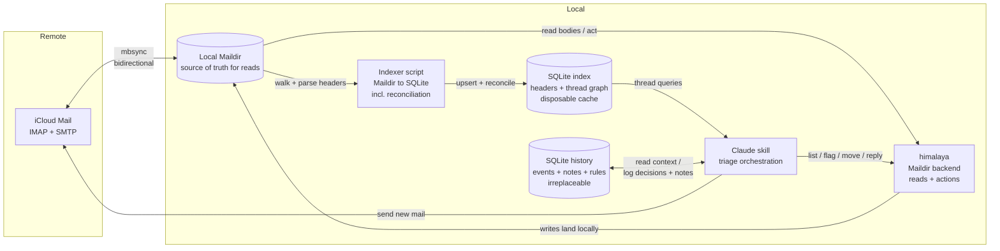

# Email Maintenance Skill — Design Document

**Status:** Draft / pre-implementation
**Backend target:** iCloud + Gmail (standard IMAP)
**Primary consumer:** Claude (via a Claude skill), not a human UI
**Companion:** `implementation-plan.md` (phased rollout: MVP → full stack)

---

## 1. Summary

A Claude-driven email maintenance system for two accounts, iCloud and Gmail.
Instead of talking to the accounts' IMAP servers directly on every operation,
the system keeps a **local Maildir mirror** (synced by `mbsync`) and a **local
SQLite index** of message headers. Claude assembles conversation **threads** from the index for fast,
cross-folder triage, and executes decisions (flag / reply / move / trash)
through `himalaya` pointed at the local Maildir, with changes propagated back to
iCloud on the next sync.

A second, separate SQLite database — the **history DB** — records every triage
decision, running session notes, and standing rules, so each session starts
informed by past behavior instead of cold.

The design grew out of a specific realization: everything expensive or fragile
in this workflow is on the **read/analysis** side (assembling threads across
folders), and that is exactly the part a local mirror makes cheap. Actions stay
remote-bound regardless, so they are left as thin `himalaya` calls.

---

## 2. Goals

- **Thread-centric triage.** Reason about conversations, not individual messages.
- **Cross-folder threading.** A conversation spanning INBOX + Sent + Archive is
  assembled as one unit. (This is the hard requirement that rules out several
  simpler approaches — see §5.)
- **Fast, offline-capable analysis.** Thread assembly should not require one
  IMAP round-trip per message.
- **Minimal, trustworthy state model.** One meaningful flag, clearly defined
  (see §10).
- **Sessions that learn.** Decisions, overrides, and observations persist across
  sessions (§9), so triage quality compounds instead of resetting.
- **Human-in-the-loop by construction.** The skill drafts and proposes; the user
  approves. See §4 Operating rules.
- **A clean split between sync, indexing, reading, and acting**, so each piece
  can be built, tested, and replaced independently.

## 3. Non-goals

- **Gmail-style labels / arbitrary tags.** iCloud is standard IMAP (one folder
  per message); reliable multi-label membership isn't available. Abandoned
  deliberately.
- **A general email client.** No HTML rendering, no TUI. Claude is the interface.
- **Real-time push.** Triage is run on demand (or scheduled), not event-driven.
- **Depending on Neverest.** Evaluated and deferred — beta, single-developer,
  explicitly "not for production." `mbsync` is the mature tool for this role.

---

## 4. Operating rules

These are behavioral commitments, not implementation details.

1. **Approval gate.** The skill never sends mail and never destroys or moves
   mail without the user approving that specific action in-session:
   - **Send / reply:** the full draft is always shown; nothing is sent without
     explicit approval of that draft.
   - **Trash / archive:** approval required, but batchable ("archive these 12?").
   - **Flagging:** low-risk and reversible; the skill may flag autonomously
     during triage.
2. **`\Flagged` is a reserved word across all clients.** The skill treats
   `\Flagged` as "needs my reply." That means the flag button in Apple Mail —
   and the **star** in Gmail clients — becomes a *queue-for-the-skill* action. This is a feature — you can
   triage from your phone — but it's a contract with yourself: don't use the
   flag for anything else in any client.
3. **Trash means the Trash folder.** "Delete" in this system is a *move to
   Trash*, never a `\Deleted`-flag-plus-expunge. Final purging is left to
   iCloud's Trash auto-clean. This keeps every destructive action reversible
   for ~30 days.
4. **Unsubscribe links are surfaced, never followed.** Claude extracts
   unsubscribe links and presents them for the user to act on manually; it
   never navigates to or interacts with the link itself.

---

## 5. Background: constraints that shaped the design

These are the findings that drove the architecture. Recording them so the
reasoning isn't lost.

- **IMAP is fundamentally folder-scoped.** The base protocol only searches the
  selected mailbox. Cross-mailbox search exists as an optional extension
  (RFC 7377 MULTISEARCH) but iCloud support is unconfirmed, so it can't be
  relied on.

- **`himalaya message thread` is folder-scoped.** It delegates to IMAP's
  threading, which only sees the selected folder. Concretely: **once a thread is
  archived and later gets a new inbox reply, the command returns only the new
  reply**, disconnected from the archived history. Since the whole model archives
  resolved threads, this breaks on essentially every returning conversation.
  Threading is therefore done from the local index; the command plays no role
  in this design.

- **Gmail-over-IMAP has quirks the config must absorb.** Every message appears
  in `[Gmail]/All Mail` *and* under each of its labels, so the Gmail sync
  channel excludes All Mail and archiving uses an explicit `Archive` label,
  keeping folder semantics identical to iCloud's. Gmail's IMAP lacks the SORT
  capability, so `himalaya envelope search` fails against it — `envelope list`
  works fine, and post-MVP all queries are local anyway. `\Flagged` surfaces
  as the **star** in Gmail clients, which extends phone triage (§4.2) to both
  accounts for free.

- **Numeric IMAP IDs are per-folder.** The same message gets a *new* id when
  moved or copied. IDs therefore cannot be used as a cross-folder key. The
  stable cross-folder key is the **`Message-ID` header**.

- **`Message-ID` is sender-controlled, not guaranteed.** Duplicates happen (you
  were CC'd *and* the list delivered a copy) and some automated senders omit the
  header entirely. The schema treats Message-ID as a join key, not an identity
  (see §8).

- **How real clients thread across folders:** Apple Mail (and others) don't use
  IMAP threading for the UI. They sync all message headers into a **local index**
  and build threads themselves from `Message-ID` / `In-Reply-To` / `References`.
  This design copies that approach.

- **`himalaya` has a first-class Maildir backend.** Its shared command surface
  (`envelope list`, `message read`, `flag`, folder ops) is a least-common-
  denominator set that works identically across IMAP and Maildir. The same
  skill logic runs against the local mirror.

- **Maildir gives us full headers locally.** Unlike the lightweight IMAP
  envelope (which omits `In-Reply-To`/`References`), reading Maildir files
  exposes the **full `References` chain** — making thread reconstruction more
  robust than the IMAP-only path ever could be.

- **Maildir flag operations rename files.** Flags are encoded in the filename
  suffix (`<unique>:2,FS`), so flagging a message *changes its filename*. Two
  consequences: (a) the index must key on the stable stem, not the full
  filename, or every flag change looks like a delete + add; (b) any file path
  or himalaya id cached before an action can be stale after it (see §12).

- **A cross-folder move syncs as delete + re-append.** mbsync propagates a local
  move as "delete from source, upload to target" — the message gets a new UID
  (harmless; identity here is Message-ID / maildir key) but the **entire
  message, attachments included, is re-uploaded**. Archiving a 20 MB thread
  costs a 20 MB upload. Acceptable; just known.

---

## 6. Architecture overview



**One-line role summary**

| Component | Role |
|-----------|------|
| `mbsync` (isync) | Bidirectional IMAP ↔ Maildir sync. Owns all IMAP complexity. |
| Local Maildir | Source of truth for **reads**. One file per message. |
| SQLite index (`index.db`) | Header + thread-graph index. **Disposable cache** — rebuildable from the Maildir. |
| SQLite history (`history.db`) | Decisions, session notes, contacts, rules. **Irreplaceable** — the file that gets backed up. |
| Indexer script | Walks Maildir, parses headers, upserts into the index, **reconciles moves and deletions**. |
| `himalaya` (Maildir backend) | Reads message bodies; composes replies; executes flag/move/delete. |
| SMTP (via `himalaya` send or `msmtp`) | Outgoing mail. |
| Claude skill | Orchestrates the triage phases; the decision-maker (with approval gates). |

---

## 7. Component details

### 7.1 `mbsync` — sync layer

- Mature, stable, C, `brew install isync`. Bidirectional; propagates new
  messages, deletions, and flag changes both ways. Sync is UID-based so no
  identity conflicts.
- **Write-back must be configured explicitly — do not rely on defaults.** The
  channel needs `Sync All` and `Expunge Both` (verify exact syntax against the
  isync manual for the installed version). Under-configured channels leave
  deletions unpropagated: mail trashed locally silently persists on iCloud, or
  lingers `\Deleted`-flagged without being expunged. This is the single most
  common mbsync foot-gun.
- `CopyArrivalDate yes` so moved messages keep their original arrival dates
  rather than appearing as "new" at move time.
- `Patterns * !Inactive/*` directly implements the active/inactive folder split
  (§15) — inactive folders simply aren't synced or indexed.
- **One channel per account.** iCloud syncs normally. The Gmail channel
  additionally excludes `[Gmail]/All Mail` (every message would otherwise land
  twice — once per label, once in All Mail) and archives to an explicit
  `Archive` label so both accounts share identical folder semantics.
  Special-folder names differ per account (`Sent` vs `[Gmail]/Sent Mail`,
  etc.); the skill carries a per-account folder map. On first run the skill
  bootstraps it: `folder list` per account, confirm archive/trash targets with
  the user, write the config.
- **Scheduling discipline:** all syncs are **skill-invoked at safe points** —
  session start, after each approved action batch, and session end. Batch-
  boundary syncs are safe because the skill holds the lock and nothing is in
  flight; they keep other clients (the phone) fresh mid-session and cap an
  abandoned session's unsynced exposure at one batch. An incremental mbsync of
  an active mailbox is expected to take seconds (measure once — §15); only the
  initial clone is slow. Abandonment never loses data regardless: mbsync is
  bidirectional, so the *next* session's start sync propagates anything left
  behind — the cost of abandonment is delayed propagation, not loss. No
  cron/launchd sync while a session may be active; any scheduled sync must
  respect the session lockfile (§12) — a sync racing the act phase invalidates
  files mid-operation.

### 7.2 Local Maildir — read source of truth

- Standard format: folders are directories, each message a file, flags encoded
  in the filename. Universally understood by Unix mail tooling.
- Because writes via `himalaya` land here first and sync back asynchronously,
  the Maildir is authoritative for reads between syncs.

### 7.3 SQLite index — threading + state

- Chosen over DuckDB deliberately: this is an **OLTP** workload (frequent
  single-row upserts, key lookups, small range scans), not columnar analytics.
  SQLite is built into Python and trivially portable/backup-able.
- Schema in §8.

### 7.4 Indexer script — Maildir → SQLite

Python stdlib only (`mailbox`, `email`, `sqlite3`). Runs after every sync.
**Three passes, in this order:**

1. **Snapshot** (all active folders): walk `cur/` + `new/`, producing the set of
   `(folder, maildir_key, current_filename, mtime)`. The **maildir key** is the
   filename stem before the `:2,` flags suffix — the stable identity of a file
   within its folder across flag renames.
2. **Upsert** (all folders, before any deletions are processed):
   - Unknown `(folder, maildir_key)` → parse full headers, insert row.
   - Known key with changed filename → flags changed; re-derive flags from the
     filename suffix (cheap — no full re-parse) and update the row.
3. **Reconcile orphans** (only after *all* folders are upserted): for each DB
   row whose `(folder, maildir_key)` no longer exists on disk:
   - If the same `message_id` now exists in a *different* folder → the message
     **moved**; delete the stale row (the new-folder row was created in pass 2).
   - Otherwise → the message was **genuinely deleted**; delete the row.

   The ordering is what makes moves recognizable: additions must land before
   orphan resolution, across all folders, or a move looks like a deletion.

**Output contract: the indexer emits a change report.** Reconciliation is not
silent — the indexer's return value is the structured diff it just computed
(new messages, moves, deletions, flag changes). The skill consumes this report
to log external actions as `manual` events (§9); built as a silent reconciler,
the indexer would discard exactly the knowledge the history DB needs.

Notes:
- Flag changes are *not* misread as delete + add because identity is the stable
  maildir key, not the full filename.
- Messages with a **missing Message-ID** get a deterministic synthetic one at
  index time (e.g. `synthetic-<hash of Date+From+Subject>`), so threading logic
  never has to special-case nulls. Synthetic IDs never match real ones, which is
  the correct behavior (such messages thread only by subject fallback).
- Dates are normalized to **UTC ISO 8601 at index time** (`date_utc`), so
  inactive-days math never wrestles with mixed timezones.
- **Trash is indexed** — reconciliation needs it to classify an external
  INBOX → Trash transition as a move rather than a deletion — but Trash
  members are excluded from triage surfacing and thread-state rollup (§10).
  iCloud's ~30-day auto-purge then appears as genuine deletion and the rows
  age out naturally.

### 7.5 `himalaya` (Maildir backend) — read + action layer

- All mutations go through here: `flag add` (needs-reply), `message move`
  (archive / trash), `message reply` (which also sets `\Answered`).
- Reading full bodies for Claude to draft replies also goes through here.
- **Why keep himalaya at all**, given that flag/move on a local Maildir are
  literally file renames Python could do? Because **reply composition and
  sending are the parts not worth reimplementing**: correct quoting, MIME
  handling, and above all constructing `In-Reply-To`/`References` on outgoing
  replies so our own messages join their threads. Keeping reads and simple file
  ops on himalaya too means one consistent interface instead of two half-owners
  of the Maildir.
- Version note: v1.2.0 is the current stable line; a v2 is in development on
  `master` with CLI/schema changes. Pin to whichever is installed; §13 test 4
  verifies the envelope JSON shape before any code trusts it.

### 7.6 The Claude skill — orchestration

- Phase-based, mirroring the PR-review-triage structure. See §11.
- Enforces the operating rules in §4 (approval gates).
- Reads history context (recent session notes, rules, sender stats) at session
  start; logs every decision and noteworthy observation as it goes (§9).

### 7.7 Packaging & installation

- Shipped as a **Claude Code plugin**: a repo with `.claude-plugin/plugin.json`
  and the skill at `skills/email-triage/SKILL.md`, with helper scripts and
  schema DDL under the skill directory. Distributed via the existing personal
  plugin marketplace repo — one new entry in its `marketplace.json`. Install on
  any machine: `/plugin marketplace add` + `/plugin install`.
- **Code/state separation is mandatory.** Installed plugins are copied into a
  read-only cache and replaced wholesale on update, and cannot reference files
  outside their own directory — so nothing mutable lives in the plugin. All
  machine state goes in a data directory (default
  `~/.local/share/email-triage/`, overridable): `config.yaml` (accounts,
  folder map, Maildir path), `history.db`, `index.db`. The Maildir location is
  config, not convention.
- **Nothing personal in the repo.** `history.db` is personal email metadata
  and `config.yaml` names accounts; the repo holds code, DDL, and docs only.
- **Dependencies are checked, not installed.** First run verifies `himalaya`
  (and post-Phase-2, `mbsync` + Python 3), walks the user through anything
  missing, then runs the config bootstrap (§7.1). This check is what makes the
  plugin installable by other users, not just on the author's machines.
- **Development** happens against the working copy via `claude --plugin-dir
  <repo>`; publication to the marketplace when stable, with `ref`/`sha`
  pinning available once versions matter.
- **Multi-machine caveat:** the Maildir and index are per-machine by design
  (rebuildable), but `history.db` is not — triaging from several machines
  forks the behavioral history. Options: a designated primary triage machine,
  or a data dir on synced storage with the session lockfile (§12) guarding
  concurrent runs. Open question (§15).

---

## 8. Index data model (`index.db`)

A single table. Threads are a query-time derivation from the envelope graph
(recursive CTE), not a stored entity, so there is no threads table. Per-folder
sync state isn't needed either: active vs. inactive is encoded by the
`Inactive/` path convention, and per-message `indexed_at` plus the snapshot
pass give incrementality.

```sql
CREATE TABLE envelopes (
    id               INTEGER PRIMARY KEY,       -- surrogate key
    message_id       TEXT NOT NULL,             -- Message-ID header (or synthetic-*); join key, NOT identity
    folder           TEXT NOT NULL,
    maildir_key      TEXT NOT NULL,             -- filename stem before ':2,'; stable across flag renames
    maildir_file     TEXT NOT NULL,             -- current full filename; updated on flag change
    in_reply_to      TEXT,
    references_chain TEXT,                      -- full ancestry (JSON array); robust threading
    subject          TEXT,
    from_addr        TEXT,
    to_addr          TEXT,
    date_utc         TEXT,                      -- Date header normalized to UTC ISO 8601
    flags            TEXT,                      -- raw flag set (JSON array)
    is_flagged       INTEGER NOT NULL DEFAULT 0,-- denormalized: '\Flagged' present
    is_answered     INTEGER NOT NULL DEFAULT 0, -- denormalized: '\Answered' present
    account          TEXT,
    indexed_at       TEXT,                      -- for incremental re-index (compare to file mtime)
    UNIQUE (folder, maildir_key)
);

CREATE INDEX idx_message_id  ON envelopes(message_id);
CREATE INDEX idx_in_reply_to ON envelopes(in_reply_to);
CREATE INDEX idx_folder_date ON envelopes(folder, date_utc);
```

**Why identity works this way.** Message-ID is sender-controlled: duplicate
deliveries of the same Message-ID (CC + list) and missing Message-IDs both
occur in real mailboxes, so it cannot be a primary key. **A row's identity is
the physical file** — `(folder, maildir_key)` — and `message_id` is an indexed
join key for threading. This matches reality: the Maildir is the source of
truth, and the DB indexes it.

The denormalized `is_flagged` / `is_answered` booleans exist so the thread
rollup (§10) is a plain SQL expression instead of JSON parsing in the hot query.

---

## 9. History data model (`history.db`)

### Purpose and principles

The history DB is what lets sessions compound: Claude reads it at session start
to triage with the benefit of past behavior, and writes to it continuously as
decisions are made and observations occur. The approach follows proven prior
art — Gmail Priority Inbox, SaneBox, and Gnus adaptive scoring all converge on
per-sender behavioral signals (what you *did* with a sender's past mail) as
the strongest triage predictor.

Three principles govern the design:

1. **Separate file, separate lifecycle.** The index is a disposable cache,
   rebuildable from the Maildir at any time. The history is the opposite —
   irreplaceable behavioral record, and the one file that gets backed up. They
   must not share a fate (`rm index.db` while debugging must never touch
   history).
2. **Self-contained rows.** Because the index can be rebuilt (with new surrogate
   ids) at any time, history never foreign-keys into it. Every event snapshots
   the context it needs — sender, subject, thread state — at decision time,
   using natural keys (`Message-ID`, email address) only.
3. **Facts, not aggregates.** Tables store what happened and what was asserted.
   Statistics (reply rates, trash rates) are **views derived from events**,
   never hand-maintained columns. The moment a computed stat appears as a
   stored column, the design has failed.

There is deliberately **no sessions lifecycle table.** Sessions may be
abandoned midway, so any `ended_at` field would be unreliable exactly when it's
most interesting. Instead, every row carries `session_started_at` — the
timestamp taken at the start of the triage run — which serves as both session
identifier and grouping key. Session duration, end time, and per-session counts
all fall out of `GROUP BY session_started_at`. Everything stays append-only.

### Schema

```sql
CREATE TABLE events (
    id                 INTEGER PRIMARY KEY,
    session_started_at TEXT NOT NULL,     -- session identity; shared by all rows in a run
    occurred_at        TEXT NOT NULL,     -- UTC ISO 8601 throughout
    account            TEXT,
    -- what was acted on (snapshot, self-contained)
    thread_root_id     TEXT,              -- root Message-ID of the thread
    message_id         TEXT,              -- specific message, if action was per-message
    sender_addr        TEXT NOT NULL,     -- normalized lowercase
    subject            TEXT,
    -- context at decision time
    thread_state       TEXT,              -- needs-reply | holding | waiting
    category           TEXT,              -- content classification at decision time:
                                          -- spam-noise | marketing | newsletter |
                                          -- passive-update | ambiguous | actionable
    inactive_days      INTEGER,
    -- the decision (the learning signal)
    proposed_action    TEXT NOT NULL,     -- flag | reply | archive | trash | skip
    final_action       TEXT NOT NULL,
    from_folder        TEXT,
    to_folder          TEXT,              -- populated for archive/trash/move
    decided_by         TEXT NOT NULL CHECK (decided_by IN
                         ('auto','approved','override','manual')),
    rule_id            INTEGER,           -- if a rule drove the proposal
    notes              TEXT,
    unsubscribed       INTEGER NOT NULL DEFAULT 0  -- user-confirmed only; see below
);
CREATE INDEX idx_events_sender  ON events(sender_addr);
CREATE INDEX idx_events_session ON events(session_started_at);

CREATE TABLE session_notes (
    id                 INTEGER PRIMARY KEY,
    session_started_at TEXT NOT NULL,
    written_at         TEXT NOT NULL,
    note               TEXT NOT NULL
);
CREATE INDEX idx_notes_session ON session_notes(session_started_at);

CREATE TABLE contacts (
    addr         TEXT PRIMARY KEY,        -- normalized lowercase email
    display_name TEXT,
    relation     TEXT,                    -- concise human description:
                                          -- 'dad', 'plumber', 'dentist', 'HOA'
    is_vip       INTEGER NOT NULL DEFAULT 0,
    notes        TEXT,
    updated_at   TEXT
);

CREATE TABLE rules (
    id          INTEGER PRIMARY KEY,
    created_at  TEXT NOT NULL,
    active      INTEGER NOT NULL DEFAULT 1,
    predicate   TEXT NOT NULL,            -- e.g. 'sender = ship-confirm@amazon.com'
    action      TEXT NOT NULL,
    origin      TEXT NOT NULL CHECK (origin IN ('user','claude-proposed'))
);

CREATE VIEW sender_stats AS
SELECT sender_addr,
       COUNT(*)                            AS events_total,
       SUM(final_action != 'skip')         AS decisions,      -- decisive actions only
       SUM(final_action  = 'skip')         AS skips,
       -- action rates over DECISIVE actions, so chronic skipping
       -- can't dilute them into meaninglessness
       AVG(final_action = 'reply') FILTER (WHERE final_action != 'skip') AS reply_rate,
       AVG(final_action = 'trash') FILTER (WHERE final_action != 'skip') AS trash_rate,
       AVG(decided_by = 'override') FILTER (WHERE decided_by != 'manual')
                                           AS override_rate,  -- over Claude's proposals only
       MAX(occurred_at)                    AS last_seen_at
FROM events GROUP BY sender_addr;
```

### `events` — the decision log

The `proposed_action` / `final_action` / `decided_by` trio is the heart of the
table: **overrides are the richest learning signal.** "Claude proposed archive,
user replied instead" teaches more than a thousand agreements. A high
`override_rate` on a sender — or on a rule, via `rule_id` — is the signal to
change behavior or retire the rule.

**Skip semantics.** "Skip" hides three different situations, and only some of
them are events:

1. **Deliberate deferral** — Claude proposed an action, the user said "leave
   it." Always logged (`proposed=<action>, final=skip, decided_by=override`);
   this is the richest override signal in the system.
2. **Nothing to do** — Claude itself proposed skip on a thread that presented a
   real decision. Logged, at most once per thread per session: "consciously
   left in place N sessions running" is distinguishable from "sat in inbox
   N sessions" only if reviewed-and-deferred is recorded. This enables the
   nudge: "deferred five times now — archive, or a real long-term hold?"
3. **Never reviewed** — session abandoned, or "skip the rest." **Not logged as
   events**; that would be false data. Resume state belongs in
   `session_notes`.

Threads in the `waiting` state are not skip-eligible — there is nothing to
decide about a thread waiting on someone else, so logging "skip" for them every
session would be pure noise.

**Unsubscribe tracking is necessarily self-reported.** Rule §4.4 means the
skill never follows a `List-Unsubscribe` link, so clicking it happens in the
user's browser — an action the skill structurally cannot observe. `events`
carries an `unsubscribed` boolean (default 0) set only when the user
confirms, in-session, that they clicked it; the skill asks rather than
inferring it from `final_action`. Without this column the only available
proxy would be "marketing/newsletter thread ended in trash/archive," which
conflates deleting one message with ending a subscription — exactly the kind
of derived-looking-like-a-fact mistake §9's "facts, not aggregates" principle
exists to avoid. Added post-MVP, during the first live triage session, when
"how often do I actually unsubscribe from marketing mail" came up as a
question the original schema couldn't answer.

**External actions become events.** Mail is also managed outside sessions —
from the phone, from Apple Mail. Because the skill re-indexes its own actions
immediately during the act phase (§12), the index is fully consistent at
session close; therefore any change the next session-start reconciliation
detects is provably external. The skill consumes the indexer's change report
(§7.4) and logs:

- **INBOX → Trash / INBOX → Archive moves and flag changes** as events with
  `decided_by = 'manual'` and `proposed_action = final_action`;
- **new Sent messages** as `manual` *reply* events — an external reply
  otherwise never becomes an event, blinding `reply_rate` to exactly the
  casual phone behavior that is often the most honest signal. The counterparty
  (`sender_addr`) is resolved via the Sent message's `In-Reply-To` parent.

`occurred_at` for manual events is detection time, not action time — the real
moment lies somewhere since the previous session, and the approximation is
acknowledged rather than guessed at. Accepted caveat: if the index is ever
rebuilt from scratch, the comparison baseline is lost and that one window of
external changes goes unlogged.

### `session_notes` — the running log

A running notes table Claude appends to **the moment anything noteworthy
happens** — never at session close, which may never come. It carries what the
event log structurally cannot:

- **Resume state.** "Abandoned midway — got through needs-reply, never touched
  holding." Skipped threads leave a skip event; *abandoned* threads leave
  nothing at all. Absence of data is ambiguous; a note isn't.
- **Stats context.** "Mass cleanup of two-year backlog" explains why one
  session's 300 trash events shouldn't be read as the normal trash rate for
  those senders.
- **Watch items.** "Warranty contractor's reply expected this week" — soft
  intent that should shape upcoming sessions without being formalized as a rule.

At session start, Claude pulls notes from the last N sessions —
`session_started_at` makes this a trivial query — and factors them into the
run.

### `contacts` — asserted facts only

Holds only what the user or Claude explicitly asserts: relation, VIP status,
freeform notes. `relation` gives triage its human framing — "email from your
plumber" beats "email from a vendor." Everything statistical about a contact
(reply rate, last interaction) is derived from events via views. If a computed
stat ever appears as a column here, the facts/aggregates rule has been
violated.

### `rules` — history turned into behavior

The actionable output of the analytics. Claude reads active rules at session
start and applies them (still within §4's approval gates); when sender stats
justify it, Claude proposes a new rule ("you've trashed the last 12 from this
sender unread — auto-trash rule?"). `origin` records whether a rule was
user-stated or Claude-proposed; effectiveness is derivable by joining events on
`rule_id` rather than tracked in the table.

### Analytics access

For richer analysis than SQLite comfortably expresses (windowed trends, "triage
volume by month," sender-domain breakdowns), **DuckDB attaches both SQLite
files read-only** and queries them in place — including joins across index and
history. DuckDB is strictly a lens: all writes to both files remain owned by
the Python scripts. Nothing in the system depends on DuckDB existing.

---

## 10. Threading & state model

### Thread assembly

1. **Link** messages by `Message-ID` ← `In-Reply-To`, supplemented by the full
   `References` chain (survives gaps a pure parent-walk would miss).
2. **Subject fallback, guarded.** Messages with no usable header links may merge
   into a thread by normalized subject (strip `Re:`/`Fwd:`) **only if the
   groups share at least one participant address**. Unguarded subject matching
   merges every unrelated "Invoice" thread in the mailbox. The guard
   occasionally *splits* a legitimate thread (headers absent *and* participants
   entirely changed) — accepted, since Claude sees both fragments during triage
   anyway.
3. **Assemble** a thread as the connected component over those links — a
   recursive CTE seeded from any member, or grouping by References-chain root.
4. **Two entry modes:** by single message (return its full thread) or by
   account set (return all threads with ≥1 member in an active inbox).

### Flag & state model

Single meaningful state, within flags guaranteed to work everywhere:

| Situation | Representation |
|-----------|----------------|
| **Needs my reply** | `\Flagged` on the latest message |
| **Holding pattern** (new-untriaged *or* replied-and-waiting) | in inbox, unflagged |
| **Replied / waiting** (metadata only) | `\Answered` — set automatically by `himalaya message reply`; queried, not acted on |
| **Resolved** | user decides; message moves out of inbox → Archive or Trash |

- "Resolved" is a manual judgment (topic closed, no reply expected), not an
  automated trigger.
- Finer state, if ever needed, goes in the history DB — never a custom IMAP
  keyword.

### Thread-level rollup

Based on the **latest message** in the thread (never "any message ever
flagged," so stale mid-thread flags can't pollute state). **Only INBOX and
Sent messages participate in the rollup** — Archive and Trash members provide
thread history and context but never drive state. This keeps the table total
under external partial cleanup (e.g. trashing just the newest message of a
thread from the phone), where the literal latest message may sit in Trash:

| Latest message in thread is… | Thread state |
|------------------------------|--------------|
| in Sent | `waiting` (your reply was the last activity) |
| in inbox, `\Flagged` | `needs-reply` |
| in inbox, unflagged | `holding` |

### "Inactive days" per thread

- **holding / needs-reply:** days since the latest message's `date_utc`.
- **waiting:** days since **your** last reply (latest Sent message in the
  thread) — computable locally because Sent is in the Maildir.

---

## 11. Data flow: a triage run

```mermaid
sequenceDiagram
    participant SKILL as Claude skill
    participant MB as mbsync
    participant IDX as Indexer
    participant DB as index.db
    participant HIST as history.db
    participant HIM as himalaya
    participant IC as iCloud

    SKILL->>SKILL: acquire session lock; stamp session_started_at
    SKILL->>HIST: read recent session notes, rules, sender stats
    SKILL->>MB: sync (session start)
    MB<<->>IC: reconcile Maildir ↔ iCloud
    SKILL->>IDX: index
    IDX->>DB: upsert + reconcile moves/deletions
    SKILL->>DB: assemble active-inbox threads + rollups
    Note over SKILL: triage: per thread, decide<br/>flag / reply / archive / trash / skip<br/>(informed by history context)
    loop each approved batch
        SKILL->>DB: resolve messages → CURRENT maildir files/ids
        SKILL->>HIM: execute approved actions
        HIM->>HIM: writes land in local Maildir
        SKILL->>HIST: log events (proposed, final, decided_by)
        SKILL->>IDX: re-index touched folder rows
        SKILL->>MB: sync (batch boundary)
    end
    Note over SKILL,HIST: session notes appended the moment<br/>anything noteworthy happens
    SKILL->>IC: send approved replies (SMTP)
    SKILL->>MB: sync (session end)
    SKILL->>SKILL: release session lock
```

Phase breakdown:

1. **Sync** — read history context; `mbsync` pulls latest state (session start).
2. **Index** — upsert + reconcile into the index.
3. **Assemble** — build threads with rollup state + inactive-days.
4. **Triage** — Claude reviews each active-inbox thread informed by notes,
   rules, and sender stats; proposes actions; collects approvals per §4.
5. **Act** — execute via `himalaya` / SMTP in approved batches, logging every
   event, re-indexing, and syncing at each batch boundary; final sync at
   session end.

One rule for mid-session syncs: they may pull **new arrivals**, which the
indexer will index, but the triage set is *not* re-assembled mid-session — the
set assembled in phase 3 is the session's working set, and new mail waits for
the next session. This keeps sessions deterministic and terminable.

### The triage phase, in detail

Phase 4 follows a classify-first discipline:

1. **Classify everything before reading anything.** Every thread is classified
   from envelope data (sender, subject, date) plus history (`sender_stats`,
   `contacts.relation`, active rules) — no body reads. Two axes per thread:
   - **Lifecycle state** (§10): needs-reply / holding / waiting.
   - **Content category:** spam-noise, marketing, newsletter, passive-update
     (receipts, notifications), ambiguous, actionable.
2. **Priority scan, before the breakdown.** Security and time-sensitive
   signals are surfaced first, regardless of the content category they'd
   otherwise land in, and this is an explicit, every-session rule — not left
   to in-the-moment model judgment. (Discovered as a gap during the MVP's
   first real session: Claude *did* prioritize a fresh sign-in alert
   unprompted, but on its own reasoning, which isn't a reliable contract
   across sessions or models.) In scope: new sign-in/device notifications,
   new SSH/API key or app-password creation, password/recovery-info or
   MFA changes, suspicious charges or payment-method changes, account/domain
   expiration warnings, and "action required"/deadline-bound language.
   These are presented individually and immediately — before category counts,
   before anything else — with a proposed action of "confirm it was you" or
   "surface the review/revoke link" (§4.4: never followed). Logged as
   `category=actionable` with the priority-scan trigger noted in the event's
   free-text `notes`.
3. **Present the breakdown next.** Before any other action or body read, the
   user sees the full category summary with counts and a proposed next step —
   "147 threads: 12 spam, 31 marketing, 14 newsletters, 58 passive updates,
   9 ambiguous, 9 actionable. Clear spam first?"
4. **Work categories easiest-first**, noise before attention: spam → marketing
   → newsletters → passive updates → ambiguous → actionable. Each category is
   shown as a grouped list with a proposed bulk action (batchable approval per
   §4); the user can pull individual threads out before approving. Actionable
   threads are always presented individually.
5. **Targeted body reads only.** Bodies are read for exactly two reasons —
   resolving an *ambiguous* classification, or extracting unsubscribe links
   from marketing/newsletters — category by category as each is worked, never
   upfront, never for confidently classified mail. Post-MVP a body read is a
   local Maildir file read.
6. **Unsubscribe extraction** prefers the `List-Unsubscribe` header (reliable)
   over body-scraped links (false-positive prone), and follows §4.4: surfaced,
   never followed. Since the click itself is invisible to the skill, it asks
   whether the user unsubscribed and logs the answer on `events.unsubscribed`
   (§9) — the only way that signal ever enters the history.

The category lands on each logged event (§9), so `sender_stats` can answer
questions like "what fraction of this domain's mail is marketing I trash?"

Session notes are not a phase — they're written continuously, whenever
something noteworthy occurs, so an abandoned session still leaves its handoff
behind.

---

## 12. Act-phase session discipline

The correctness checklist for a running session:

- **Session lockfile** for the whole run; any external sync must check it (§7.1).
- **Resolve-before-act.** Flag operations rename Maildir files (§5), so resolve
  `message_id → current file/id` immediately before each action; never reuse a
  pre-assembled reference for a second action.
- **Re-index and log as you go** — actions re-index touched rows immediately,
  and events are written at act time, never batch-flushed at close. An
  abandoned session must leave a consistent index and its full history.
- **External-change detection** falls out of the point above: session-start
  reconciliation findings are provably external, and are logged as `manual`
  events (§9).
- **Mid-session external races are accepted, not solved.** If the user trashes
  a message from the phone while the skill flags it locally, the next sync
  resolves the conflict and the server-side action typically wins. Correct
  priority — a direct user action outranks the skill — but history can record
  an action whose effect never survived.

---

## 13. Pre-build verification suite

Cheap tests that gate the build. Each is minutes of effort and protects days.
Run every test against **both accounts** — the answers can differ (Gmail
historically auto-saves sent mail to its Sent folder; iCloud may not).

1. **Sent-copy behavior.** Send one message through the configured SMTP path;
   check the server's Sent folder in webmail. Determine whether iCloud's SMTP
   auto-saves to Sent. If it does *and* himalaya also saves a local Sent copy,
   **every reply will duplicate after sync** — disable one side (prefer the
   server copy). If it doesn't, configure himalaya to save to the local Sent
   Maildir and let mbsync push it up.
2. **Reply threading headers.** Generate a reply with `himalaya message reply`
   and inspect the raw outgoing message for `In-Reply-To` and `References`. If
   absent, our own replies won't join their threads in our own index and the
   `waiting` state breaks — fix config or construct the headers in the skill's
   reply template before building anything downstream.
3. **mbsync round-trip.** Locally flag, move, and trash one message each; sync;
   verify all three on iCloud (webmail). Then the reverse: change state from
   Apple Mail on the phone; sync; verify the indexer classifies each correctly
   (flag-change → update, move → move, delete → delete — *not* delete + new).
4. **Envelope JSON schema.** Confirm field names/shapes on the installed
   himalaya version before any code trusts them (wrapped vs. bare list; flags
   as strings vs. objects; `from` as object vs. list).

---

## 14. Dependencies

| Dependency | Purpose | Maturity / risk |
|------------|---------|-----------------|
| `mbsync` (isync) | IMAP ↔ Maildir sync | Mature, stable, widely packaged. Foot-gun: write-back must be configured explicitly (§7.1). |
| `himalaya` | Body reads, reply composition (quoting + threading headers), flag/move, sending | Stable v1.2.0; v2 in dev — pin & verify (§13.4). Kept because composition/sending aren't worth reimplementing (§7.5). |
| SQLite | Index + history stores | Built into Python; rock solid; archival-grade file format |
| Python 3 stdlib (`mailbox`, `email`, `sqlite3`) | Indexer + event logging | No third-party deps |
| SMTP sender (`himalaya` send or `msmtp`) | Outgoing mail | Standard; behavior verified by §13.1 |
| Password source (1Password CLI / `pass` / keyring) | Credentials for mbsync + SMTP | Keep secrets out of plaintext config |
| DuckDB | *(optional)* read-only analytics over both SQLite files | Nothing depends on it; add only when wanted |
| **Neverest** | *(evaluated, not adopted)* | Beta, single-dev, "not for production." Revisit only at a stable 1.0. |

---

## 15. Open questions

1. **Folder audit.** Enumerate top-level folders, decide which are active, move
   the rest under `Inactive/` (a rename in IMAP terms — easiest in Apple Mail).
   Leave special-use folders (Sent, Trash) at top level regardless of recency.
2. **Indexer performance at real mailbox size.** Expected trivial for the
   active set; only matters if a large Archive is indexed in full. Measure once
   with real data before optimizing anything.
3. **iCloud custom-keyword behavior** — moot under this design (state is
   `\Flagged` + local DB); only relevant if custom flags are ever reconsidered.
4. **Rule predicate language.** Start with the simplest thing (sender equality,
   maybe sender + subject-contains) and let real usage drive any richer
   predicate syntax.
5. **Sync latency.** Measure an incremental `mbsync` against the real mailbox
   once configured; the batch-boundary cadence (§7.1) assumes seconds, not
   minutes. If it measures slow, fall back to syncing only the folders the
   batch touched, or to session-boundary syncs.
6. **Cross-account moves.** himalaya has no native cross-account move; for now
   the user handles these in a native client. Revisit if the need is real
   (likely path: export raw message, append to the destination account).
7. **Multi-machine history.** Decide between a designated primary triage
   machine and a synced data directory (lockfile-guarded) before installing on
   a second computer. Per-machine forked histories are the silent default if
   undecided.

---

## 16. Build sequence

Rollout is phased: an **MVP** (direct-IMAP triage + history logging, no local
mirror) precedes this full build — see `implementation-plan.md`. The sequence
below is the full stack.

1. **`mbsync` → both accounts** into a local Maildir, `Patterns * !Inactive/*`,
   explicit `Sync All` / `Expunge Both` / `CopyArrivalDate yes`. Verify Sent +
   Archive come down.
2. **Run the verification suite (§13).** Gate everything downstream on it —
   especially the round-trip test, which validates the riskiest assumption in
   the stack (bidirectional correctness).
3. **Folder audit.** Move inactive folders under `Inactive/`.
4. **Indexer** with the three-pass reconciliation (§7.4).
5. **Thread assembly queries.** Recursive CTE / References-root grouping; the
   two entry modes; rollup + inactive-days.
6. **`himalaya` action wiring** with resolve-before-act discipline and the
   session lockfile (§12).
7. **History DB + event logging.** Schema from §9; wire event writes into the
   act path and note-writing into the whole session.
8. **The skill.** Orchestrate the five phases; approval gates per §4; history
   context read at session start.

---

## Appendix: key decisions log

Rationale lives in the body; this is the index of choices.

- Inbox Zero + GTD hybrid: active mail stays in inbox until *the user* resolves it → Archive/Trash.
- One flag: `\Flagged` = needs-reply; everything else in inbox is holding; `\Answered` is metadata.
- `\Flagged` reserved system-wide — flagging in any client queues for the skill.
- Approval gate: drafts always shown; sends/moves/trash approved in-session; flags may be autonomous.
- Trash = move to Trash folder, never expunge; iCloud auto-purge finalizes.
- Threads, not messages; thread state = latest INBOX/Sent message's state.
- Threads derived at query time, never stored; the index is a single `envelopes` table.
- No Gmail-style labels (multi-label tagging); both accounts in scope from day
  one — the Gmail channel excludes All Mail and archives to an explicit label.
- MVP first: direct-IMAP triage with history logging from session one; the full
  stack follows (see `implementation-plan.md`).
- Local Maildir + SQLite index, copying how real clients thread across folders.
- `mbsync` for sync, not Neverest (maturity).
- SQLite for both stores, not DuckDB (OLTP vs OLAP); DuckDB optional as a read-only lens.
- Two files, two lifecycles: `index.db` disposable cache, `history.db` irreplaceable and backed up.
- No sessions lifecycle table; session identity = `session_started_at` on every row, append-only.
- Running session notes, written the moment anything is noteworthy — never at a close that may not come.
- History is self-contained: natural keys + decision-time snapshots; no FKs into the index.
- Facts, not aggregates: stats are views over events, never stored columns.
- `proposed_action` / `final_action` / `decided_by` trio captures the override signal.
- Skips are events only when a real decision was presented (once per thread per session); `waiting` threads aren't skip-eligible; rates computed over decisive actions.
- Rules turn history into behavior; user- or Claude-proposed; effectiveness derived via `rule_id`.
- Syncs are skill-invoked: session start, batch boundaries, session end; abandonment costs at most one batch of delayed propagation.
- External changes are first-class: the indexer emits a change report; detected external actions (including replies from Sent) become `manual` events.
- Mid-session races resolve in the user's favor; accepted, not solved.
- Thread state from INBOX + Sent only; Trash indexed for move classification but never surfaced.
- Row identity = `(folder, maildir_key)`; `message_id` is a join key, not a primary key.
- Synthetic Message-IDs at index time for messages missing the header.
- Subject fallback requires participant overlap before merging.
- Classify-first triage: everything classified from envelopes + history before any body read; category breakdown presented before any action; categories worked easiest-first (noise before attention).
- Priority scan ahead of the breakdown: security/time-sensitive threads (new sign-in, new SSH/API key, MFA change, suspicious charge, expiration/deadline language) always surface first, as an explicit rule rather than incidental model judgment (added after the MVP's first session).
- Two classification axes: lifecycle state and content category; the category is snapshotted on every event.
- Targeted body reads only: ambiguity resolution and unsubscribe extraction.
- Unsubscribe links surfaced (`List-Unsubscribe` header preferred), never followed.
- Unsubscribe outcome is self-reported: `events.unsubscribed` is set only when the user confirms in-session, since the click itself is structurally invisible to the skill (added after the MVP's first session, prompted by wanting an "unsubscribe rate by category" metric the original schema couldn't answer).
- Contacts carry `relation` — human framing ('your plumber') over generic categories.
- Packaged as a Claude Code plugin, distributed through the existing personal marketplace; developed locally via `--plugin-dir`.
- Strict code/state separation: the plugin is read-only code; all state lives in a machine-local data dir (`~/.local/share/email-triage/` by default); nothing personal in the repo.
- Dependencies checked and bootstrapped on first run, never bundled.
